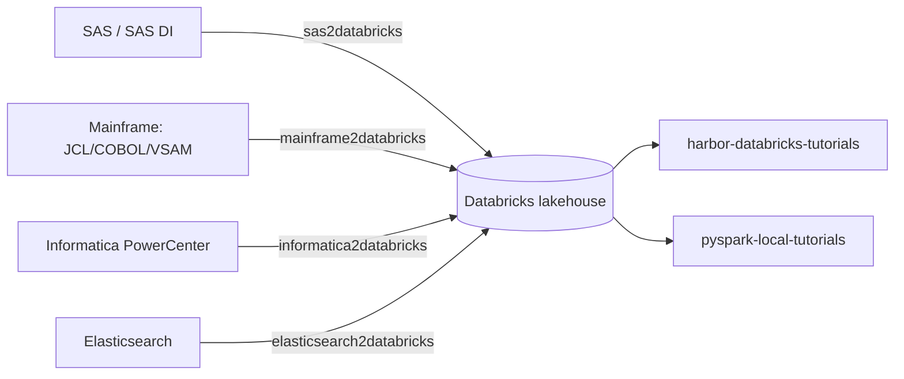

# Legacy → Databricks Migration Demos

A family of small, **locally runnable** demos that migrate common enterprise data
platforms to a Databricks lakehouse — each with legacy artifacts, a converter, an
end-to-end runner, validation (legacy vs Databricks parity), docs and CI.



## The repos

| Repo | Source system | Migrates | Converter / app | Runs locally | Tests |
|---|---|---|---|---|---|
| [sas2databricks-demo](https://github.com/memo8212/sas2databricks-demo) | SAS / SAS DI Studio | DI job → workflow, PROC SQL/DATA step, medallion, risk engine | `converter/sas2dbx_converter.py` | ✅ | ✅ |
| [mainframe2databricks-demo](https://github.com/memo8212/mainframe2databricks-demo) | Mainframe | JCL, COBOL, VSAM KSDS, DB2, CICS; EBCDIC/COMP-3 | `mftranspile` (COBOL→PySpark app) | ✅ | ✅ |
| [informatica2databricks-demo](https://github.com/memo8212/informatica2databricks-demo) | Informatica PowerCenter | mappings, sessions, worklets, mapplets, workflow, params, SCD2 | `infa2dbx` (CLI app) | ✅ | ✅ |
| [elasticsearch2databricks-demo](https://github.com/memo8212/elasticsearch2databricks-demo) | Elasticsearch | indices, ingest pipelines, query DSL, dashboards; file registry/lineage/sharing | `converter/es2dbx_converter.py` | ✅ | ✅ |
| [harbor-databricks-tutorials](https://github.com/memo8212/harbor-databricks-tutorials) | — (learning) | Databricks basics: Spark, SQL, Delta, UC, Workflows, Lakeflow, monitoring, finance/ML | 14 notebooks + DAB | ☁️ Databricks | — |
| [pyspark-local-tutorials](https://github.com/memo8212/pyspark-local-tutorials) | — (learning) | PySpark: DataFrames, SQL, Delta, MLlib, streaming, tuning, testing | 18 runnable scripts | ✅ | ✅ |

## Which demo to read first

- **Migrating a specific source system?** Start with that repo; each has the same
  shape: `legacy/` (source artifacts) → `converter/` (parse → Databricks) →
  `runner/` (end-to-end + validation) → `docs/`.
- **New to Spark/Databricks?** `pyspark-local-tutorials` (local) then
  `harbor-databricks-tutorials` (on Databricks).
- **Building a conversion tool?** `mftranspile` and `infa2dbx` are full
  convert+verify apps.

## The shared pattern

Every migration demo does the same thing:

```
 legacy artifacts ─▶ converter ─▶ Databricks artifacts (workflow, notebook, schema, report)
        │
        └▶ runner: legacy logic (stand-in) ─▶ Parquet bridge ─▶ PySpark ─▶ validation (parity)
```

- **Legacy stand-in** re-implements the source logic in pandas so both sides run
  without the source system.
- **Money in integer cents** for exact parity with fixed-point (COBOL COMP-3,
  SAS, DB2).
- **Everything runs locally**: `pip install -r requirements.txt` + a few commands.
- **Honest reporting**: converters flag what they can't translate.

## Common requirements

```
pyspark==4.2.0
delta-spark==4.4.1
pandas==2.3.3
numpy==2.5.3
pyarrow==23.0.1
pytest==9.1.1
```
(Delta must match PySpark's major version; Java 17.)

## Convention

Each repo follows the same layout and tooling (ruff, pre-commit, pinned
requirements, pytest, GitHub Actions). New migration demos should match it.

## License

MIT — see each repository.
